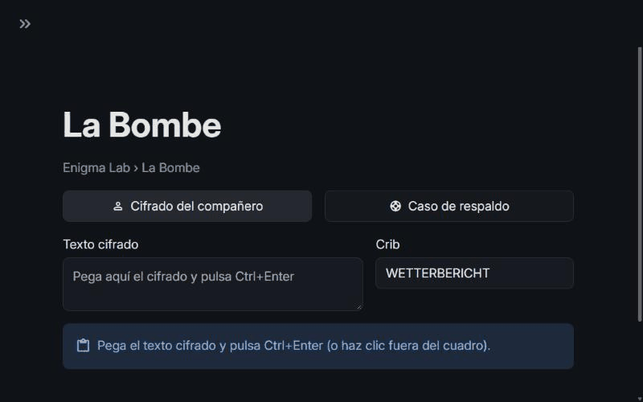
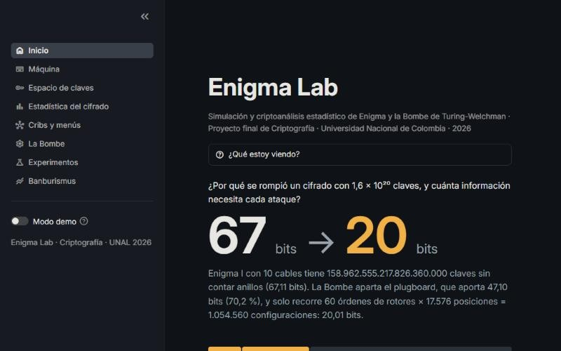
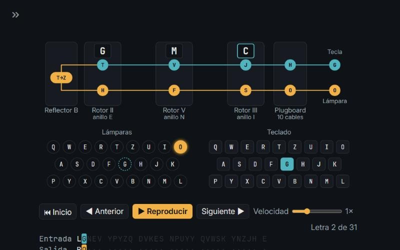
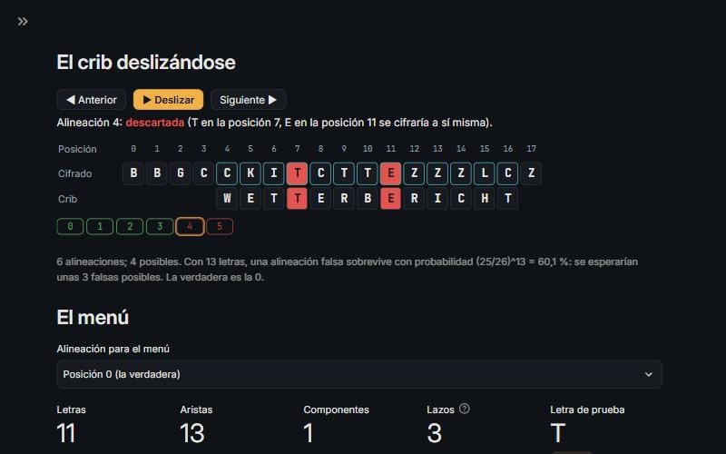
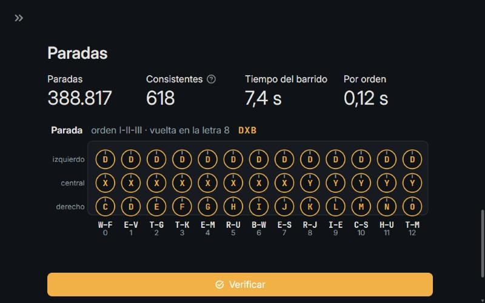
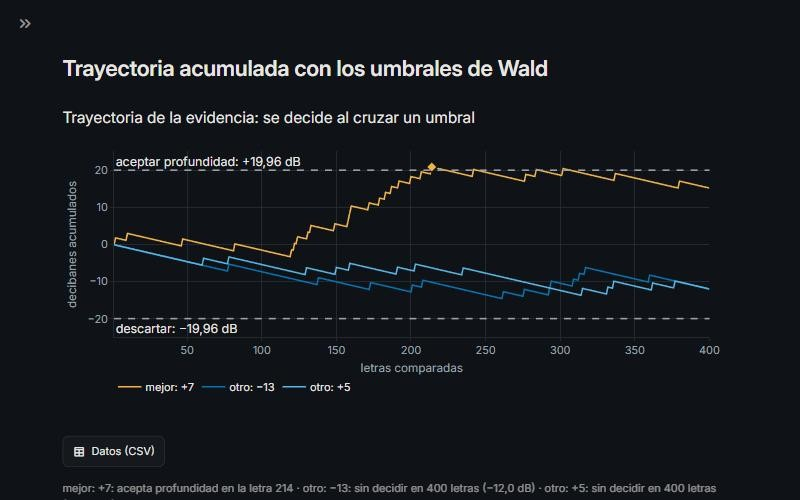

# Enigma Lab

Proyecto final de Criptografía, Universidad Nacional de Colombia (2026) · Carlos Daniel
Guarin Ortiz.

**¿Por qué se rompió un cifrado con unas 1,6 × 10²⁰ claves, y cuánta información necesita
cada ataque?** Enigma Lab simula la máquina Enigma, la Bombe de Turing-Welchman y el
Banburismus, y mide con experimentos Monte Carlo cuánto cuesta cada ataque y con qué
probabilidad funciona. La hipótesis es «divide y vencerás»: el plugboard aporta 47 de los 67
bits de la clave, pero la Bombe lo aparta y solo recorre 60 órdenes × 17.576 posiciones,
unos 20 bits.

La app sirve de demostración en vivo en la presentación y produce las cifras de sus
diapositivas: cada número sale del código o de una fuente citada.



*La demo 2 de la presentación, en modo demo: se pega el cifrado de un compañero que empieza
por WETTERBERICHT, la Bombe barre los 60 órdenes de rotores y «Verificar» descifra el
mensaje.*

| | |
| --- | --- |
|  |  |
| **Inicio.** La pregunta y la cifra «67 → 20 bits». | **Máquina.** La animación dibuja la traza que calcula Python; la lámpara de la tecla pulsada nunca se enciende. |
|  |  |
| **Cribs y menús.** Las alineaciones imposibles, en rojo. | **La Bombe.** Paradas, tambores en la parada y «Verificar». |
|  | |
| **Banburismus.** Decibanes acumulados y los umbrales de Wald. | |

## Inicio rápido

### Con Docker

```sh
docker compose up
```

y abrir http://localhost:8501. La primera vez construye la imagen (unos minutos: Python
3.12, las dependencias de `uv.lock` y los núcleos de Numba ya compilados). La imagen trae
las muestras del corpus y los resultados guardados, así que la app funciona sin internet.
Para detenerla: `docker compose down`.

### En local

1. Instala el entorno (uv, Python 3.12 y las dependencias fijadas en `uv.lock`):
   - Windows (PowerShell): `powershell -ExecutionPolicy Bypass -File scripts\install.ps1`
   - Linux o macOS: `sh scripts/install.sh`
2. Abre la app: `make app` y luego http://localhost:8501.
3. Corre las pruebas: `make test` (y `make lint` para el estilo y los tipos).

Sin make: `uv run streamlit run app/Inicio.py` y `uv run pytest`. `make help` lista todos
los objetivos.

### Modo demo, para proyectar

El interruptor «Modo demo» de la barra lateral sube la letra a 20 px como mínimo, oculta lo
que la demo no usa (las claves, los paneles «¿Qué estoy viendo?», las tablas largas) y
muestra el resultado en grande. Queda guardado en la URL: abre directamente
http://localhost:8501/maquina?demo=1 para la demo 1 y http://localhost:8501/bombe?demo=1
para la demo 2. En La Bombe, «Cifrado del compañero» deja lista la configuración que
recomendó `make bench-demo` en ese equipo, y «Caso de respaldo» es el plan B.

## Reproducir los resultados

| Comando | Qué hace |
| --- | --- |
| `make reproduce` | Descarga el corpus completo (SHA-256 verificado), corre E1 a E6 en modo completo con semilla 2026, arma `results/presentacion/` y dibuja las figuras |
| `make rapido` | Los mismos experimentos en modo rápido, con las muestras del corpus (sin internet) |
| `make resumen` | Rehace `results/presentacion/` (RESUMEN.md, cifras.json y los CSV) sin correr nada |
| `make figuras` | Figuras del informe (`report/figuras/`) y de respaldo para las diapositivas (`results/figures/slides/`) |
| `make report` | Informe: `report/numbers.tex` desde los resultados, sus figuras y el PDF si hay LaTeX (latexmk o Tectonic); si no, `report/` sirve tal cual para Overleaf |
| `make bench-demo` | Mide la demo 2 en este equipo (éxito, p50 y p95) y recomienda la configuración |

Los tiempos medidos en el equipo de desarrollo están en
[`docs/PROGRESS.md`](docs/PROGRESS.md). Los resultados de la última corrida completa ya
vienen en `results/`, así que la app y el informe los muestran sin correr nada.

| Experimento | Pregunta |
| --- | --- |
| E1 | ¿El simulador es correcto? (vectores publicados, py-enigma en 10.000 claves, propiedades) |
| E2 | ¿Cuánto aporta cada componente de la clave? |
| E3 | ¿Qué estadística se filtra y cuál no? (frecuencias, IC, χ², la diagonal en cero) |
| E4 | ¿Cuántas posiciones descarta un crib? (frente a (25/26)^L) |
| E5 | ¿Cuántas paradas falsas deja la Bombe? (frente a la tabla de Turing) |
| E6 | ¿Cuánto solapamiento necesita el Banburismus? (SPRT frente a la aproximación de Wald) |

## Estructura

```
enigma-lab/
├── app/                 la interfaz Streamlit: Inicio.py (entrada), pages/, ui/, components/ (HTML+SVG+JS) y static/fonts/
├── src/enigma_lab/      toda la lógica, en Python
│   ├── core/            máquina, paso y doble paso, cifrado por lotes, espacio de claves, vectores
│   ├── stats/           corpus, frecuencias, IC, χ², n-gramas e intervalos
│   ├── cribs/           arrastre del crib y menú
│   ├── bombe/           aleatorizador, barrido con union-find en Numba y verificador
│   ├── banburismus/     mensajes en profundidad, decibanes y prueba secuencial de Wald
│   ├── experiments/     E1 a E6 (python -m enigma_lab.experiments)
│   ├── viz/             tema «Bletchley nocturno», formato de números y gráficos Plotly
│   └── cifras.py · resumen.py · figuras.py · informe.py
├── data/                vectores y tabla de Turing (reference/), muestras del corpus (corpora/), casos de la demo (demo/)
├── results/             resultados generados: Parquet, summary.json, figures/ y presentacion/
├── report/              informe.tex, numbers.tex (generado), figuras/ e informe.pdf
├── docs/                spec, progreso, decisiones, arquitectura, validación, guía de estudio, fuentes e img/
├── tests/               pytest + hypothesis; test_presentacion.py comprueba cada cifra de las diapositivas
├── scripts/             instalación, corpus, banco de la demo 2, URL de CyberChef y el piloto original
└── Dockerfile · docker-compose.yml · Makefile · pyproject.toml · uv.lock · requirements.txt
```

La regla central: **la lógica de Enigma existe una sola vez, en Python.** Los componentes
JavaScript de `app/components/` solo animan las trazas que calcula Python. El detalle, con
diagramas, está en [`docs/ARQUITECTURA.md`](docs/ARQUITECTURA.md).

## Validación

El detalle está en [`docs/VALIDACION.md`](docs/VALIDACION.md); las cifras, en
[`results/presentacion/RESUMEN.md`](results/presentacion/RESUMEN.md).

- **Simulador (E1):** los 9 vectores de la especificación (entre ellos BDZGO, EWTYX, el ejemplo
  de py-enigma, la portada, la traza de la diapositiva 4, el caso de respaldo y un mensaje real
  del U-264); 10.000 de 10.000 claves y mensajes aleatorios iguales a py-enigma, una
  implementación independiente (Enigma I, M3 y M4); 6 de 6 casos comprobados a mano en
  CyberChef; y pruebas de propiedades con hypothesis: cifrar dos veces devuelve el texto, ninguna
  letra se cifra a sí misma y el cifrado por lotes coincide con el escalar.
- **Espacio de claves (E2):** los conteos exactos de la especificación: 158.962.555.217.826.360.000
  claves sin anillos (67,11 bits), el máximo del plugboard con 11 cables y el barrido de la Bombe,
  1.054.560 configuraciones (20,01 bits).
- **Bombe (E5):** la versión en Numba coincide con una de referencia en Python puro; en 200 casos
  aleatorios la configuración verdadera siempre produce una parada y el verificador recupera una
  clave equivalente; las paradas coinciden con CyberChef en 3 de 3 casos, y las paradas falsas
  quedan entre la mitad y el doble de la tabla de Turing en 15 de sus 17 celdas.
- **Banburismus (E6):** la simulación del SPRT se explica con un cálculo exacto: la diferencia con
  la aproximación de Wald es el sobrepaso de los umbrales.
- **Presentación:** `tests/test_presentacion.py` comprueba cada cifra de las diapositivas contra
  el código.

## Limitaciones

- **La fase 5 (P2, opcional) no se hizo:** ni el catálogo de Rejewski (E7, que se compararía con
  Kuhl 2007) ni el ataque moderno de solo texto cifrado (E8: Gillogly 1995; Ostwald y Weierud
  2017). La presentación solo cita esa literatura, y la app los marca como no incluidos.
- **El corpus es literario, no naval:** el alemán de Fontane y Kafka repite letras más que el
  tráfico naval (1 de cada 12,5 frente a 1 de cada 17), lo que acelera el Banburismus con texto
  real.
- **El verificador no es infalible:** en unos pocos casos nuevos da una clave que difiere en una
  letra (un doble paso del central justo en el borde del mensaje; ver `docs/VALIDACION.md`).
- **El modo Bletchley pierde la parada** cuando el rotor central se mueve dentro del crib (cerca
  de la mitad de las claves con WETTERBERICHT); el modo robusto la recupera, a cambio de tiempo.
- **Los tiempos son de un escritorio:** la demo 2 se midió en un i5 de 6 núcleos; hay que medirla
  en el portátil de la presentación con `make bench-demo`.
- **py-enigma admite hasta 10 cables**, así que esa comparación usa de 0 a 10; las pruebas de
  propiedades cubren de 0 a 13.
- **La imagen de Docker pesa unos 2,8 GB** por la pila científica (llvmlite, pyarrow, SciPy).
- **La CI no ha corrido todavía:** el repositorio aún no tiene remoto.

## Fuentes

La lista completa, con revisiones de Wikipedia, URL y SHA-256 del corpus, está en
[`docs/FUENTES.md`](docs/FUENTES.md). Las principales: Turing, *The Applications of Probability
to Cryptography*; Rejewski (1980); Wilcox (2006, NSA); Good (1979); Wald (1945); Kuhl (2007);
Gillogly (1995); Ostwald y Weierud (2017); las notas de Pommerening; los artículos de Wikipedia
«Bombe», «Banburismus» y «Enigma rotor details»; py-enigma; CyberChef (GCHQ); y Project
Gutenberg para el corpus.

## Documentación

- [`docs/GUIA_DE_ESTUDIO.md`](docs/GUIA_DE_ESTUDIO.md): cada algoritmo con sus fórmulas, dónde
  está en el código y las 15 preguntas más probables.
- [`docs/ARQUITECTURA.md`](docs/ARQUITECTURA.md): módulos, flujo de datos y la imagen de Docker.
- [`docs/DECISIONES.md`](docs/DECISIONES.md): las decisiones tomadas ante ambigüedades.
- [`docs/PROGRESS.md`](docs/PROGRESS.md): el estado por fase, con las cifras y los tiempos.
- [`report/informe.pdf`](report/informe.pdf): el informe de 3 páginas.
