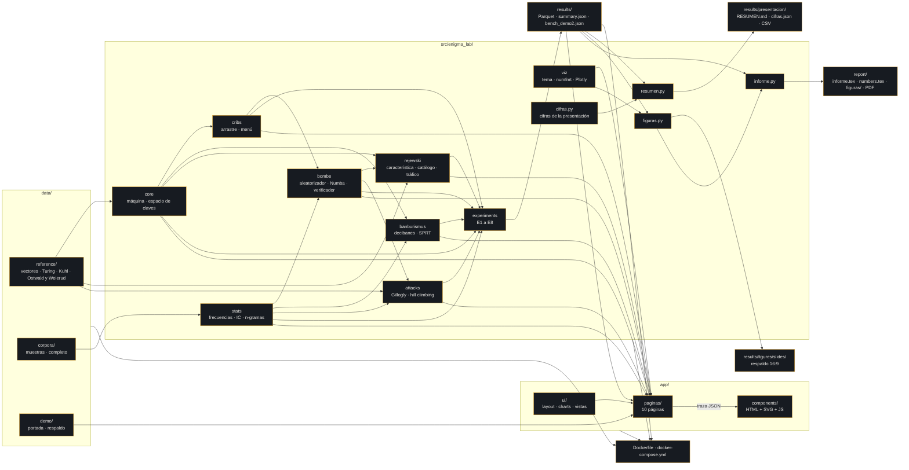
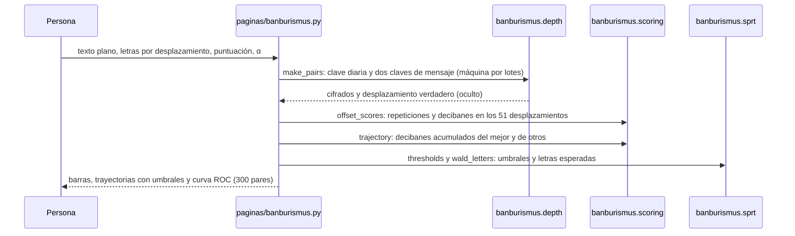
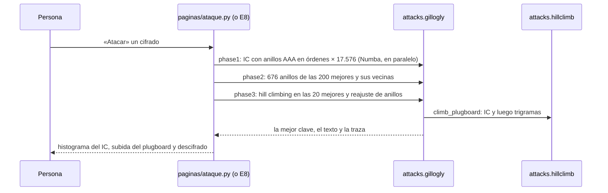
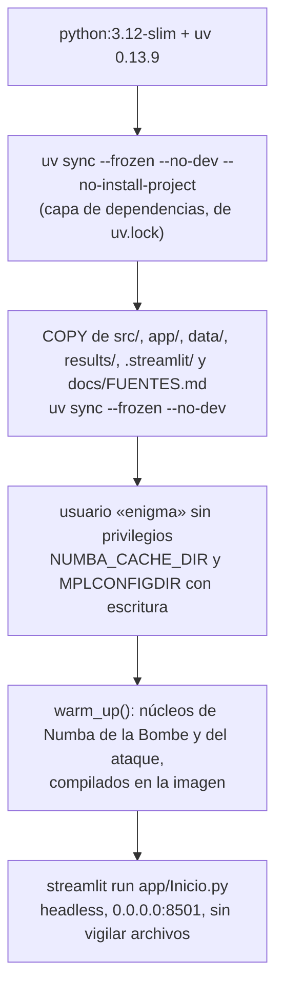

# Arquitectura

Regla central: **la lógica de Enigma existe una sola vez, en Python**,
dentro de `src/enigma_lab/`. La app de Streamlit solo la llama y la muestra; los
componentes JavaScript de `app/components/` animan una «traza» en JSON que calcula Python
y nunca reimplementan la máquina.

## Módulos y flujo de datos



**De dónde sale cada número.** Los experimentos escriben `results/summary.json` y sus
Parquet; de ahí salen, sin volver a correr nada, el resumen para las diapositivas
(`make resumen`), las figuras (`make figuras`) y las cifras del informe
(`report/numbers.tex`, `make report`). Las cifras de las diapositivas que no son resultados
(espacio de claves, vectores, pesos de Turing) las calcula `cifras.py`, y
`tests/test_presentacion.py` las compara con la presentación. La página Experimentos muestra
esos Parquet y las figuras de `results/figures/` tal como se guardaron, sin leer el corpus
completo, que no está en Docker ni en un clon sin `make corpus` (D-071).

## Estado por fase

| Pieza | Qué hay hoy | Fase |
| --- | --- | --- |
| `core/keyspace.py` | Conteos exactos del espacio de claves | 0 (adelantado) |
| `viz/theme.py`, `viz/numfmt.py` | Tema, plantilla Plotly, estilos Matplotlib y formato español | 0 |
| `app/` | Punto de entrada, navegación, modo demo, Inicio y Máquina | 0 y 1 |
| `core/wiring.py`, `stepping.py`, `machine.py` | Cableados, paso con doble paso, Enigma I, M3 y M4 con traza | 1 |
| `core/batch.py`, `random_keys.py` | Cifrado por lotes en NumPy y claves aleatorias con semilla | 1 |
| `core/vectors.py` | Vectores de prueba (`data/reference/test_vectors.json`) | 1 |
| `experiments/` | Marco común y E1 (validación) | 1 |
| `cifras.py`, `resumen.py` | Cifras de la presentación y `make resumen` | 1 |
| `app/components/enigma_machine.html` | Animación SVG que reproduce la traza | 1 |
| `stats/` | Corpus y normalización, frecuencias, IC, χ², n-gramas e intervalos | 2 |
| `cribs/` | Arrastre del crib (escalar y vectorizado) y menú con lazos y letra de prueba | 2 |
| `experiments/` E2–E4 | Espacio de claves, estadística del cifrado y supervivencia de cribs | 2 |
| `app/paginas/` | Espacio de claves, Estadística, Cribs y menús (con dos animaciones) y Experimentos | 2 |
| `bombe/scrambler.py`, `wiring.py` | Aleatorizador precalculado por orden; el menú como cables, aristas y diagonal board | 3 |
| `bombe/bombe_numba.py`, `sweep.py` | Barrido con union-find en Numba, modos Bletchley y robusto, paradas como arreglos | 3 |
| `bombe/bombe_reference.py` | La misma Bombe en Python puro (propaga hilo por hilo), solo para las pruebas | 3 |
| `bombe/checker.py`, `cases.py` | Máquina de verificación, descifrado de prueba y clave equivalente; casos de prueba | 3 |
| `stats/ngrams.py` (interpolado) | Modelo de 4 letras interpolado y puntaje por la regla de la cadena | 3 |
| `experiments/` E5 | Paradas falsas por letras y lazos, con y sin diagonal board, frente a Turing | 3 |
| `app/paginas/bombe.py`, `components/bombe_drums.html` | Página La Bombe y los tambores | 3 |
| `scripts/bench_demo2.py` | `make bench-demo`: éxito y tiempos de la demo 2 | 3 |
| `banburismus/depth.py` | Pares en profundidad cifrados con la máquina real; desplazamiento verdadero por estados | 4 |
| `banburismus/scoring.py` | Decibanes de Turing, modelo de rachas para multigramas y puntaje por desplazamiento | 4 |
| `banburismus/sprt.py` | Umbrales y aproximación de Wald, cálculo exacto con sobrepaso y SPRT en Numba | 4 |
| `experiments/` E6 | SPRT frente a Wald, aciertos por solapamiento, identificación del desplazamiento y ROC | 4 |
| `app/paginas/banburismus.py` | Página Banburismus y pestaña E6 en Experimentos | 4 |
| `rejewski/characteristic.py` | El indicador doble, AD, BE y CF, su estructura de ciclos y las 101 particiones de 13 | 5 |
| `rejewski/catalog.py` | El catálogo de las 105.456 configuraciones (I–III, reflector A) con las tablas de la Bombe | 5 |
| `rejewski/traffic.py` | Un día de tráfico con la máquina real, la completación con el teorema y el coleccionista de cupones | 5 |
| `attacks/gillogly.py` | Las tres fases de Gillogly en Numba, con vecinas y reajuste de anillos | 5 |
| `attacks/hillclimb.py` | Hill climbing del plugboard con IC y trigramas, y la búsqueda parcial de la E | 5 |
| `experiments/` E7, E8 | El catálogo frente a Kuhl y los mensajes por día; el éxito del ataque según la longitud | 5 |
| `app/paginas/rejewski.py`, `components/cycles.html` | Página Rejewski: el tráfico, los ciclos y la búsqueda en el catálogo | 5 |
| `app/paginas/ataque.py` | Página Ataque moderno: la curva del IC, el hill climbing y la curva de éxito | 5 |
| `scripts/kuhl_variantes.py` | 33 variantes de los supuestos del catálogo frente a Kuhl | 5 |
| `app/ui/layout.py` | Modo demo: 20 px, paneles ocultos, resultado en grande y `?demo=1` en la URL | 6 |
| `app/ui/charts.py` | Gráficos con su descarga de datos (CSV) y figuras del informe diferidas | 6 |
| `figuras.py` | Figuras del informe (`report/figuras/`) y respaldo 16:9 de las diapositivas | 6 |
| `informe.py`, `report/informe.tex` | `numbers.tex` desde los resultados y compilación con latexmk o Tectonic | 6 |
| `Dockerfile`, `docker-compose.yml` | Imagen con uv, Numba precompilado y la app sin internet | 6 |
| `core/keyspace.py`, `stepping.py`, `banburismus/depth.py` | Conexiones con el curso: 25!! y 26!, ataque paralelo, la ρ del paso y el cumpleaños de las claves de mensaje | Después de la 6 |
| `app/ui/course.py` | La línea «En clase» de cada página y de cada pestaña de Experimentos | Después de la 6 |

## Flujo de una letra en la página Máquina

```mermaid
sequenceDiagram
    participant U as Persona
    participant P as paginas/maquina.py
    participant E as core.machine.Enigma
    participant V as ui/machine_view.py
    participant J as enigma_machine.html (JS)
    U->>P: clave y texto
    P->>E: trace(texto)
    E-->>P: LetterTrace por letra (ventanas, doble paso, etapas)
    P->>V: render_machine(clave, trazas)
    V->>J: JSON incrustado en el HTML
    J-->>U: animación (solo dibuja; no cifra)
```

## Flujo de la página La Bombe

```mermaid
sequenceDiagram
    participant U as Persona
    participant P as paginas/bombe.py
    participant W as bombe.wiring
    participant S as bombe.sweep (Numba)
    participant C as bombe.checker
    participant J as bombe_drums.html (JS)
    U->>P: «Cifrado del compañero» y pega el cifrado (o «Caso de respaldo»)
    P->>W: wiring_from_menu(crib, tramo)
    W-->>P: cables, aristas y pares del diagonal board
    loop por orden de rotores
        P->>S: run_order: union-find en las 17.576 posiciones
        S-->>P: paradas (arreglos) → barra, contador y cronómetro
    end
    P->>C: consistent_stops (máquina de verificación)
    U->>P: «Verificar»
    P->>C: verify: puntaje rápido, anillos, hill climbing
    C-->>P: clave equivalente y texto descifrado
    P->>J: JSON con las letras de cada tambor en la parada
    J-->>U: tambores (solo dibuja; no calcula)
```

## Flujo de la página Banburismus



E6 usa las mismas piezas con miles de pares y corre la prueba con el núcleo de Numba
(`sprt.run_sprt`); la página solo usa NumPy.

## Flujo de la página Rejewski

```mermaid
sequenceDiagram
    participant U as Persona
    participant P as paginas/rejewski.py
    participant T as rejewski.traffic
    participant C as rejewski.catalog
    participant V as ui/rejewski_view.py
    participant J as cycles.html (JS)
    U->>P: mensajes interceptados («Otro día»)
    P->>T: simulate_day: clave de 1932 y 250 indicadores con la máquina real
    P->>T: known_after, completions: lo conocido de AD, BE y CF y si ya quedó determinado
    P->>V: cycles_payload: ciclos, cadenas y coordenadas
    V->>J: JSON incrustado en el HTML
    J-->>U: los ciclos (solo dibuja; no calcula)
    P->>C: build_catalog (una vez) y la característica del día
    C-->>P: las configuraciones candidatas
```

## Flujo del ataque moderno



## La imagen de Docker



`ENIGMA_LAB_ROOT=/app` le dice a `enigma_lab.paths` dónde está el repositorio. La imagen
trae las muestras del corpus y `results/`, así que la app funciona sin internet.

## Convenciones de código

- Identificadores en inglés; docstrings y comentarios en español, explicando la
  matemática.
- Rutas con `pathlib`, desde `enigma_lab.paths`.
- Azar siempre con `numpy.random.Generator` sembrado (semilla global 2026).
- Las páginas importan sus utilidades como `ui.*` (`app/ui/`), porque Streamlit pone
  `app/` en `sys.path`.
- Las páginas viven en `app/paginas/` y no en `app/pages/`: con una carpeta `pages/` junto a
  `Inicio.py`, Streamlit arranca en su modo antiguo de varias páginas y la primera página que
  se abre directo corre sin pasar por el punto de entrada (D-079). Una prueba lo vigila
  (`tests/test_app.py`).
- Ninguna página deja texto suelto a nivel de módulo: la magia de Streamlit lo dibujaría
  (`tests/test_pages.py`).
