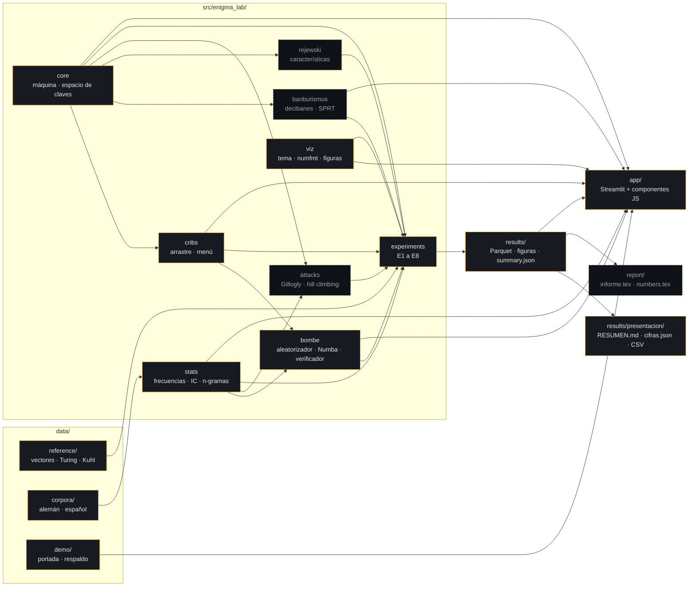

# Arquitectura

Regla central (spec, sección 3): **la lógica de Enigma existe una sola vez, en Python**,
dentro de `src/enigma_lab/`. La app de Streamlit solo la llama y la muestra; los
componentes JavaScript de `app/components/` animan una «traza» en JSON que calcula Python
y nunca reimplementan la máquina.

## Módulos y flujo de datos

En gris punteado, lo que llega en fases siguientes.



## Estado por fase

| Pieza | Qué hay hoy | Fase |
| --- | --- | --- |
| `core/keyspace.py` | Conteos exactos del espacio de claves | 0 (adelantado) |
| `viz/theme.py`, `viz/numfmt.py` | Tema, plantilla Plotly, estilos Matplotlib y formato español | 0 |
| `app/` | Punto de entrada, navegación, modo demo, Inicio y Máquina | 0 y 1 |
| `core/wiring.py`, `stepping.py`, `machine.py` | Cableados, paso con doble paso, Enigma I, M3 y M4 con traza | 1 |
| `core/batch.py`, `random_keys.py` | Cifrado por lotes en NumPy y claves aleatorias con semilla | 1 |
| `core/vectors.py` | Vectores de 6.1 (`data/reference/test_vectors.json`) | 1 |
| `experiments/` | Marco común y E1 (validación) | 1 |
| `cifras.py`, `resumen.py` | Cifras de la presentación y `make resumen` | 1 |
| `app/components/enigma_machine.html` | Animación SVG que reproduce la traza | 1 |
| `stats/` | Corpus y normalización, frecuencias, IC, χ², n-gramas e intervalos | 2 |
| `cribs/` | Arrastre del crib (escalar y vectorizado) y menú con lazos y letra de prueba | 2 |
| `experiments/` E2–E4 | Espacio de claves, estadística del cifrado y supervivencia de cribs | 2 |
| `app/pages/` | Espacio de claves, Estadística, Cribs y menús (con dos animaciones) y Experimentos | 2 |
| `bombe/scrambler.py`, `wiring.py` | Aleatorizador precalculado por orden; el menú como cables, aristas y diagonal board | 3 |
| `bombe/bombe_numba.py`, `sweep.py` | Barrido con union-find en Numba, modos Bletchley y robusto, paradas como arreglos | 3 |
| `bombe/bombe_reference.py` | La misma Bombe en Python puro (propaga hilo por hilo), solo para las pruebas | 3 |
| `bombe/checker.py`, `cases.py` | Máquina de verificación, descifrado de prueba y clave equivalente; casos de prueba | 3 |
| `stats/ngrams.py` (interpolado) | Modelo de 4 letras interpolado y puntaje por la regla de la cadena | 3 |
| `experiments/` E5 | Paradas falsas por letras y lazos, con y sin diagonal board, frente a Turing | 3 |
| `app/pages/bombe.py`, `components/bombe_drums.html` | Página La Bombe y los tambores | 3 |
| `scripts/bench_demo2.py` | `make bench-demo`: éxito y tiempos de la demo 2 | 3 |
| `banburismus/` | Decibanes y SPRT | 4 |
| `rejewski/`, `attacks/` | Extensiones P2 | 5 |

## Flujo de una letra en la página Máquina

```mermaid
sequenceDiagram
    participant U as Persona
    participant P as pages/maquina.py
    participant E as core.machine.Enigma
    participant V as ui/machine_view.py
    participant J as enigma_machine.html (JS)
    U->>P: clave y texto
    P->>E: trace(texto)
    E-->>P: LetterTrace por letra (ventanas, doble paso, etapas)
    P->>V: render_machine(clave, trazas)
    V->>J: JSON incrustado en el HTML
    J-->>U: animación (solo dibuja; no cifra)
```

## Flujo de la página La Bombe

```mermaid
sequenceDiagram
    participant U as Persona
    participant P as pages/bombe.py
    participant W as bombe.wiring
    participant S as bombe.sweep (Numba)
    participant C as bombe.checker
    participant J as bombe_drums.html (JS)
    U->>P: cifrado, crib y alineación (o «Caso de respaldo»)
    P->>W: wiring_from_menu(crib, tramo)
    W-->>P: cables, aristas y pares del diagonal board
    loop por orden de rotores
        P->>S: run_order: union-find en las 17.576 posiciones
        S-->>P: paradas (arreglos) → barra, contador y cronómetro
    end
    P->>C: consistent_stops (máquina de verificación)
    U->>P: «Verificar»
    P->>C: verify: puntaje rápido, anillos, hill climbing
    C-->>P: clave equivalente y texto descifrado
    P->>J: JSON con las letras de cada tambor en la parada
    J-->>U: tambores (solo dibuja; no calcula)
```

## Convenciones de código

- Identificadores en inglés; docstrings y comentarios en español, explicando la
  matemática.
- Rutas con `pathlib`, desde `enigma_lab.paths`.
- Azar siempre con `numpy.random.Generator` sembrado (semilla global 2026).
- Las páginas importan sus utilidades como `ui.*` (`app/ui/`), porque Streamlit pone
  `app/` en `sys.path`.
