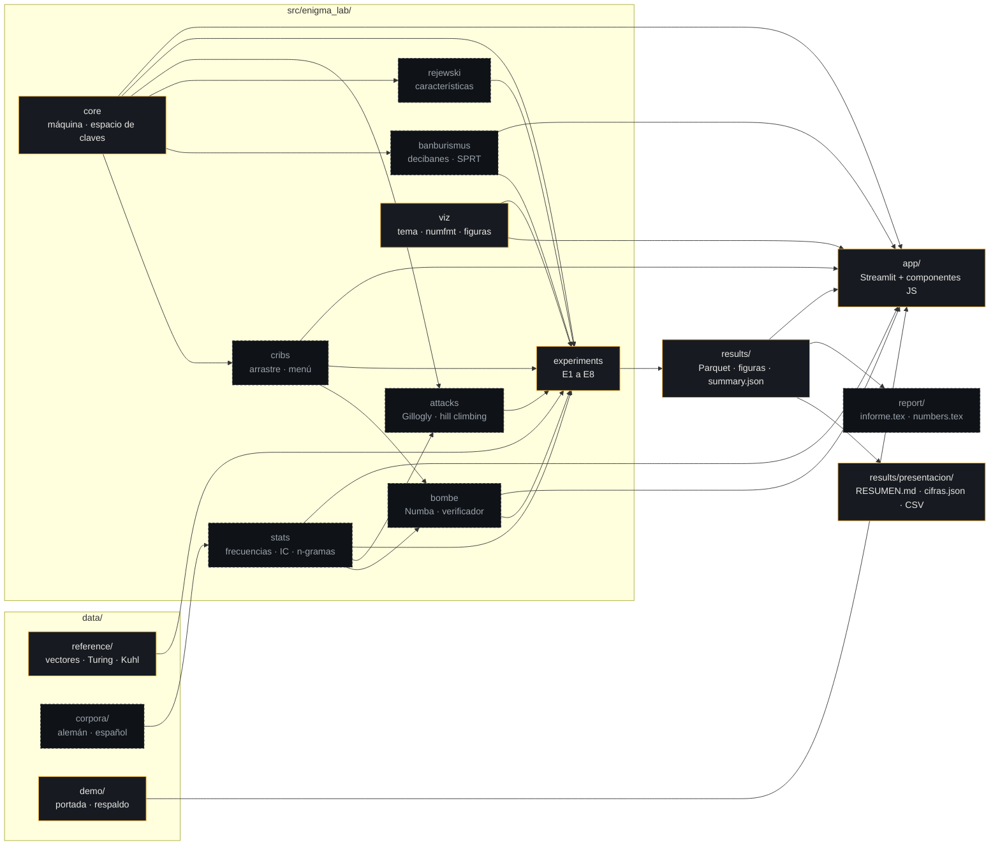

# Arquitectura

Regla central (spec, sección 3): **la lógica de Enigma existe una sola vez, en Python**,
dentro de `src/enigma_lab/`. La app de Streamlit solo la llama y la muestra; los
componentes JavaScript de `app/components/` animan una «traza» en JSON que calcula Python
y nunca reimplementan la máquina.

## Módulos y flujo de datos

En gris punteado, lo que llega en fases siguientes.



## Estado por fase

| Pieza | Qué hay hoy | Fase |
| --- | --- | --- |
| `core/keyspace.py` | Conteos exactos del espacio de claves | 0 (adelantado) |
| `viz/theme.py`, `viz/numfmt.py` | Tema, plantilla Plotly, estilos Matplotlib y formato español | 0 |
| `app/` | Punto de entrada, navegación, modo demo, Inicio y Máquina | 0 y 1 |
| `core/wiring.py`, `stepping.py`, `machine.py` | Cableados, paso con doble paso, Enigma I, M3 y M4 con traza | 1 |
| `core/batch.py`, `random_keys.py` | Cifrado por lotes en NumPy y claves aleatorias con semilla | 1 |
| `core/vectors.py` | Vectores de 6.1 (`data/reference/test_vectors.json`) | 1 |
| `experiments/` | Marco común y E1 (validación) | 1 |
| `cifras.py`, `resumen.py` | Cifras de la presentación y `make resumen` | 1 |
| `app/components/enigma_machine.html` | Animación SVG que reproduce la traza | 1 |
| `stats/`, `cribs/` | Estadística del idioma, arrastre y menús (hoy solo `stats/inference.py`) | 2 |
| `bombe/` | Bombe en Numba, versión de referencia y verificador | 3 |
| `banburismus/` | Decibanes y SPRT | 4 |
| `rejewski/`, `attacks/` | Extensiones P2 | 5 |

## Flujo de una letra en la página Máquina

```mermaid
sequenceDiagram
    participant U as Persona
    participant P as pages/maquina.py
    participant E as core.machine.Enigma
    participant V as ui/machine_view.py
    participant J as enigma_machine.html (JS)
    U->>P: clave y texto
    P->>E: trace(texto)
    E-->>P: LetterTrace por letra (ventanas, doble paso, etapas)
    P->>V: render_machine(clave, trazas)
    V->>J: JSON incrustado en el HTML
    J-->>U: animación (solo dibuja; no cifra)
```

## Convenciones de código

- Identificadores en inglés; docstrings y comentarios en español, explicando la
  matemática.
- Rutas con `pathlib`, desde `enigma_lab.paths`.
- Azar siempre con `numpy.random.Generator` sembrado (semilla global 2026).
- Las páginas importan sus utilidades como `ui.*` (`app/ui/`), porque Streamlit pone
  `app/` en `sys.path`.
